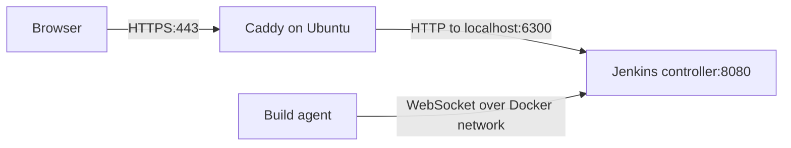

# Tutorial: set up Jenkins and a build agent on Oracle Cloud

This tutorial documents the Jenkins setup used by this project: a Dockerized
controller and a separate build agent on the Oracle Ampere A1 VM, with Ubuntu
24, 4 OCPUs and 24 GB RAM. Caddy runs directly on Ubuntu and provides HTTPS for
`jenkins.yelmach.com`.

The setup verification job has been run successfully. Follow the steps below to
reproduce the installation or understand how it works. This step establishes
Jenkins and verifies its build environment. Follow the [SonarQube tutorial](sonarqube-setup.md)
to configure code analysis and the CI quality gate.

## 1. Understand the controller and agent

The **controller** manages users, configuration, jobs and scheduling. The
**agent** executes build commands and contains the project's development tools.
The controller has zero build executors; the agent has one, so it runs one build
at a time.



The agent connects to `http://jenkins:8080/` using Docker's service DNS. Users
open `https://jenkins.yelmach.com/`. These addresses serve different purposes:
internal agent communication and public browser access.

Only the controller's web port is published, bound to `127.0.0.1:6300` on the VM.
No public agent port or port 50000 is needed for this WebSocket connection.
The Jenkins Compose project, network and volumes are separate from the running
application.

## 2. Prepare the repository and tools

The VM needs Docker Engine, the Docker Compose plugin, Git and Make. Caddy and
the domain are already part of the VM setup. Check the tools:

```bash
docker version
docker compose version
git --version
make --version
uname -m
```

On the Oracle VM, expect `aarch64`. The agent image is built natively there;
its `arm64` Jenkins label selects the node but does not emulate a CPU.

Use the existing project checkout on the VM. Pull the committed Jenkins files
from the branch containing them, then run the remaining commands from the
repository root. There is no need to clone the project again if it is already
there. For a fresh VM checkout, for example:

```bash
git clone --branch deployment https://github.com/yelmach/ecom-platform.git
cd ecom-platform
```

Use the actual branch if it differs from `deployment`. Updating the checkout
does not automatically redeploy the application.

## 3. Understand the Jenkins files

All Jenkins infrastructure lives under `infra/jenkins/`:

| File | What it does |
| --- | --- |
| [docker-compose.yml](../infra/jenkins/docker-compose.yml) | Runs the controller and agent, sets environment variables, networking, health check and persistent volumes. |
| [controller/Dockerfile](../infra/jenkins/controller/Dockerfile) | Builds the controller from Jenkins `2.580.1-jdk21`, installs plugins and includes the configuration files. |
| [controller/plugins.txt](../infra/jenkins/controller/plugins.txt) | Lists the required plugins with explicit versions. Dependencies are resolved by the plugin installer. |
| [controller/jenkins.yaml](../infra/jenkins/controller/jenkins.yaml) | Declares the administrator, permissions, public URL, executors and agent using Jenkins Configuration as Code (JCasC). |
| [controller/jobs/agent-check.groovy](../infra/jenkins/controller/jobs/agent-check.groovy) | Uses Job DSL to create or update the `agent-check` job and point it at the repository's Jenkinsfile. |
| [controller/.dockerignore](../infra/jenkins/controller/.dockerignore) | Limits the controller build context to its Dockerfile, plugin list, YAML and job scripts. |
| [agent/Dockerfile](../infra/jenkins/agent/Dockerfile) | Extends the inbound-agent image with Node 24/npm, Git, Make, Chromium, Python, native build tools and SonarScanner CLI. Java 21 comes from the base image. |
| [agent/.dockerignore](../infra/jenkins/agent/.dockerignore) | Limits the agent build context to its Dockerfile. |
| [agent-check.Jenkinsfile](../infra/jenkins/agent-check.Jenkinsfile) | Defines the verification stages executed by the agent. |
| [Root Jenkinsfile](../Jenkinsfile) | Builds/tests the application, runs SonarQube analysis and enforces its quality gate. |
| [CI job definition](../infra/jenkins/controller/jobs/ecom-ci.groovy) | Creates the `ecom-ci` job pointing at the root Jenkinsfile. |

The root [Makefile](../Makefile) wraps Compose commands. The root
[.env.example](../.env.example) lists the Jenkins settings to add to the ignored
`.env` file. Jenkins reads these Docker settings from `.env`; `.env.local`
remains for manually running the application during development.

### Why configuration is stored in code

The controller Dockerfile installs plugins using `jenkins-plugin-cli`. The
plugins have the following roles:

| Plugin | Purpose |
| --- | --- |
| `configuration-as-code` | Loads controller settings from YAML. |
| `workflow-aggregator` | Provides Pipeline support for Jenkinsfiles. |
| `git` | Checks out Git repositories. |
| `credentials-binding` | Makes stored credentials available to pipeline steps. |
| `junit` | Publishes test reports. |
| `job-dsl` | Creates jobs from Groovy definitions. |
| `matrix-auth` | Assigns permissions explicitly. |
| `sonar` | Connects analysis and quality-gate callbacks to Jenkins. |

Compose sets `CASC_JENKINS_CONFIG` to
`/usr/share/jenkins/config/jenkins.yaml`. On startup, JCasC configures:

- A local administrator account using values supplied through the environment.
- Disabled account signup and administrator permissions for the configured user.
  Anonymous users receive no granted permissions.
- Zero controller executors and the public Jenkins URL.
- One permanent inbound node named `jenkins-agent`, with one executor, workspace
  `/home/jenkins/agent`, label `arm64`, and exclusive usage for matching jobs.
- The Job DSL script that creates `agent-check` without starting a build.
- The `ecom-ci` job and SonarQube installation used by the analysis pipeline.

The Job DSL file defines **where to fetch the pipeline**. The Jenkinsfile defines
**what that pipeline does**. Both are needed to recreate the job automatically.

The YAML and Job DSL files are baked into the controller image under
`/usr/share/jenkins/config/`. They are kept outside `/usr/share/jenkins/ref/jobs/`
so Docker's reference-file copying does not put Groovy source into Jenkins'
persisted job directory. Plugin files use the image's normal reference directory.

The setup wizard is disabled through `JAVA_OPTS` because account creation and
permissions are already configured in code. There is no initial unlock-password
step. Compose sets no explicit CPU or RAM caps, and there is no explicit Java
heap limit. The JVM selects its heap size automatically. One agent executor
limits concurrent builds, not the resources an individual build can consume.

## 4. Set the root .env values

Add the Jenkins settings to the VM's existing `.env`, preserving its application
settings. For a fresh checkout with no `.env`, copy `.env.example` first and
configure its application values as needed.

```dotenv
JENKINS_PORT=6300
JENKINS_PUBLIC_URL=https://jenkins.yelmach.com/
JENKINS_ADMIN_ID=admin
JENKINS_ADMIN_PASSWORD='REPLACE_WITH_A_STRONG_PASSWORD'
JENKINS_REPOSITORY_URL=https://github.com/yelmach/ecom-platform.git
JENKINS_REPOSITORY_BRANCH=deployment
JENKINS_AGENT_SECRET=
```

Use a real strong password and the branch containing the Jenkins files. Single
quotes prevent Compose from interpreting `$` inside a password; use a password
without a single quote when using this example's quoting. Keep credentials out
of the repository URL. Leave the agent secret blank only for the first setup;
Jenkins generates it after the controller creates the node. Preserve an existing
working secret when updating an installation.

```bash
chmod 600 .env
make jenkins-config
```

Compose uses `.env` for substitution and explicitly passes only the selected
Jenkins settings into the controller. A variable existing in `.env` alone does
not make it available inside a container.

`jenkins-config` checks Compose configuration quietly. Set the controller
settings in `.env` before startup. The agent secret may be empty during initial
controller setup; set it before starting the agent. JCasC and Job DSL are
validated when Jenkins starts.
Full Compose config output includes credentials, so keep that output private.

## 5. Build and start the controller

```bash
make jenkins-up
make jenkins-ps
```

This builds the controller image and starts only the controller. The first build
downloads plugins; unchanged builds reuse Docker cache. The command waits up to
five minutes for the login endpoint to become healthy.

During startup, Jenkins reads the YAML, creates the administrator and agent
node, and creates the verification job. The agent node is initially offline
because its container has not connected yet. To inspect startup:

```bash
make jenkins-logs
```

Look for completed initialization and inspect any plugin, JCasC or Job DSL errors
if startup fails. Press Ctrl+C to stop following logs; this does not stop Jenkins.

## 6. Connect the domain through Caddy

Create a Cloudflare `A` record for `jenkins.yelmach.com` pointing to the VM's
public IP. Add an `AAAA` record only if the VM is reachable over IPv6.

Add this block to the existing `/etc/caddy/Caddyfile`, preserving other sites:

```caddyfile
jenkins.yelmach.com {
    reverse_proxy 127.0.0.1:6300
}
```

Validate and reload:

```bash
sudo caddy validate --config /etc/caddy/Caddyfile --adapter caddyfile
sudo systemctl reload caddy
```

Caddy handles public HTTPS and forwards requests over local HTTP. Keep port
6300 private; browser traffic reaches Caddy through ports 80/443. If Cloudflare
proxying is enabled, use Full (strict) once Caddy has a valid origin certificate.

Open `https://jenkins.yelmach.com/` and log in with `JENKINS_ADMIN_ID` and
`JENKINS_ADMIN_PASSWORD`. No setup wizard is required. In a private/incognito
window, viewing jobs should require login.

For a local installation, set `JENKINS_PUBLIC_URL=http://localhost:6300/` and
browse that address. Local HTTPS and a self-signed certificate are not required.

## 7. Retrieve the agent secret and connect it

In Jenkins, open **Manage Jenkins > Nodes > jenkins-agent**. This node was
created automatically; do not create a second node manually. Its settings are:

| Setting | Value |
| --- | --- |
| Name | `jenkins-agent` |
| Executors | `1` |
| Remote root | `/home/jenkins/agent` |
| Label | `arm64` |
| Usage | Only jobs with a matching label expression |
| Launcher | Inbound agent |

Copy the inbound connection secret shown on the node page into the VM's `.env`
as `JENKINS_AGENT_SECRET`. This authenticates the agent to Jenkins; it is not an
administrator password or a GitHub token.

```bash
make jenkins-agent-up
make jenkins-agent-check
```

The agent image builds, then its container connects using the node name, secret,
internal controller URL and WebSocket option from Compose. It runs as the
`jenkins` user rather than root. Check that the node is **online** in Jenkins.

The tool check should print `aarch64` on Oracle, Java 21, Node 24/npm, Git, Make
and Chromium. It also checks write access to the workspace and caches. If the
node remains offline, inspect:

```bash
make jenkins-agent-logs
```

A running container does not prove the agent has authenticated. A missing or
incorrect secret prevents connection. Start the controller first during initial
setup: a plain Compose `up` starts both services, including an unconfigured agent.

## 8. Verify Git access

The jobs use the public HTTPS repository URL from `JENKINS_REPOSITORY_URL`
and the branch from `JENKINS_REPOSITORY_BRANCH`. No Git credential is required
for the current public repository. Ensure that branch contains both
`infra/jenkins/agent-check.Jenkinsfile` and the root `Jenkinsfile`.

For a private repository, create a Jenkins Git credential and add its
`credentials('your-credential-id')` to the `remote` block in both Job DSL files
before rebuilding the controller. The current job definitions use anonymous checkout.

## 9. Run the verification pipeline

Open the automatically created **agent-check** job. There is no need to create a
Pipeline job through the dashboard.

First select **Build with Parameters** (or **Build Now**) and leave
`RUN_PROJECT_CHECKS` false. The pipeline requests the `arm64` agent and runs:

| Stage | What happens |
| --- | --- |
| Check tools | Prints tool versions and checks workspace/cache write permissions. |
| Checkout | Runs `checkout scm` and prints the checked-out commit SHA. |
| Verify project | Skipped for this quick run. |

Expect **SUCCESS**. Open the console output to verify the tools and commit SHA.
If it waits for an executor, check that the `arm64` node is online.

Then run again with `RUN_PROJECT_CHECKS` true. The final stage runs `make verify`,
which builds and tests the backend services, then builds and tests the frontend.
JUnit reports are collected from:

```text
backend/*/target/surefire-reports/TEST-*.xml
frontend/reports/junit/*.xml
```

The first full run downloads dependencies and fills the Maven/npm caches.
Production databases and the application's `.env` are not needed in the build
workspace. The pipeline has a 30-minute timeout, prevents concurrent executions
of this job, and disables the implicit checkout so checkout happens explicitly
in its own stage. Its JUnit publisher allows empty report matches, so a success
from the quick run alone does not establish that project tests have passed.

## 10. Verify restart and persistence

Restart the controller:

```bash
docker compose --env-file .env -f infra/jenkins/docker-compose.yml restart jenkins
make jenkins-ps
```

Wait for it to become healthy, then log in again. Confirm there is still one
`agent-check` job, previous build history is available, and the agent reconnects.
Run the quick job again to check that scheduling and checkout still work.

The named volumes preserve:

| Volume | Data |
| --- | --- |
| `jenkins_home` | Controller configuration, users, credentials, agent secret and jobs/build history. |
| `agent_work` | Agent work directory and build workspaces. |
| `maven_cache` | Maven downloads under `/home/jenkins/.m2`. |
| `npm_cache` | npm cache under `/home/jenkins/.npm`. |
| `sonar_cache` | Scanner engine, runtime and analyzer downloads under `/home/jenkins/.sonar`. |

Compose prefixes these names with project `jenkins`, for example
`jenkins_jenkins_home`. `make jenkins-down` removes containers and the network
while retaining volumes. Do not use `down -v` for an installation whose data you
want to keep. Back up Jenkins home, including its secrets, and protect the backup.
Replacing Jenkins home changes the generated agent secret.

## Updating the configuration

Change YAML, job definitions and plugins in Git. Then update the VM checkout
and run `make jenkins-up` to rebuild/recreate the controller when needed.
Code-managed settings, including the configured administrator password and job
definition, are reapplied on startup; dashboard edits to those settings may be
overwritten. Rebuild the agent with `make jenkins-agent-up` after changing its
Dockerfile. An unchanged `make jenkins-up` does not force a restart.

No host Docker socket or application data volumes are mounted into this Jenkins
stack. SonarQube connects to its network as described in the
[SonarQube tutorial](sonarqube-setup.md); stop that stack before removing the Jenkins
network. The current agent does not provide Docker image-building or deployment access.

## Troubleshooting

| Symptom | Check |
| --- | --- |
| Controller never becomes healthy | Inspect `make jenkins-logs` for plugin, JCasC or Job DSL errors. |
| Public hostname fails but local port works | Check DNS, the Caddy site block and `sudo systemctl status caddy`. |
| Agent remains offline | Check its node name, connection secret and `make jenkins-agent-logs`. |
| Job waits for an agent | Confirm `jenkins-agent` is online and has label `arm64`. |
| Jenkinsfile cannot be loaded | Check the repository URL, branch, committed script path and private-repository credential. |
| Full verification fails | Inspect the first failing build/test command in the job console and available test reports. |

## Command reference

Run these commands from the repository root after configuring `.env`:

| Command | Action |
| --- | --- |
| `make jenkins-config` | Validate Compose quietly. |
| `make jenkins-up` | Build/start/wait for the controller only. |
| `make jenkins-agent-up` | Build/start the agent with its configured connection secret. |
| `make jenkins-ps` | Show container state. |
| `make jenkins-logs` | Follow controller logs. |
| `make jenkins-agent-logs` | Follow agent logs. |
| `make jenkins-agent-check` | Check agent tools and cache permissions. |
| `make jenkins-down` | Remove containers/network, retaining volumes. |

References: [Jenkins Docker image](https://github.com/jenkinsci/docker),
[JCasC](https://plugins.jenkins.io/configuration-as-code/),
[Job DSL integration with JCasC](https://github.com/jenkinsci/job-dsl-plugin/blob/master/docs/JCasC.md).
